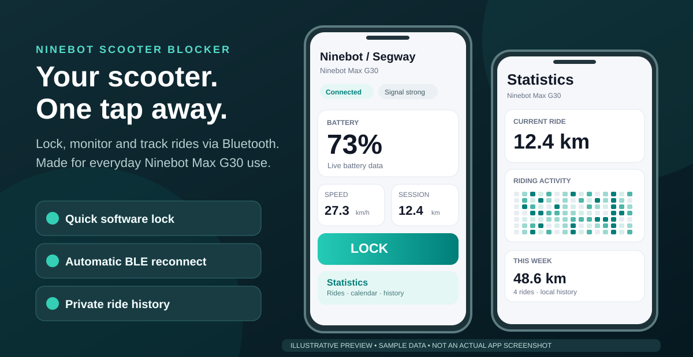

<div align="center">

# 🛴 Ninebot Scooter Blocker

### Free Android app to lock, monitor and track your Ninebot scooter

**One-tap scooter lock · Auto-reconnect · Live battery and speed · Ride history · Charging alerts**

An independent, open-source **Ninebot / Segway scooter companion** that connects directly over Bluetooth. No account, no cloud and no firmware flashing. **Hardware-tested on Ninebot Max G30.**

[](https://developer.android.com/)
[](https://github.com/Bl0ck154/Ninebot-scooter-blocker/releases/latest)
[](https://github.com/Bl0ck154/Ninebot-scooter-blocker/actions/workflows/android.yml)
[](LICENSE)

### [⬇️ Download Android APK](https://github.com/Bl0ck154/Ninebot-scooter-blocker/releases/latest) · [How to install](#get-started) · [Compatibility](#which-scooters-work)



*Illustrative UI overview with sample data — not screenshots from a device. [Real screenshot capture guide](docs/SCREENSHOT_GUIDE.md).*

</div>

## Why use it?

The official scooter app is not always the fastest way to reach the controls you use every day. Ninebot Scooter Blocker is a **small, purpose-built Android companion** focused on quick access and continuity during rides and short stops.

| What you want | What this app does |
| --- | --- |
| 🔐 **Lock your scooter quickly** | One-tap **software lock / unlock** from the dashboard, notification or optional home shortcut |
| 🔗 **Stay connected** | Remembers your scooter and attempts background **Bluetooth auto-reconnect** when it becomes available |
| 🔋 **See live scooter status** | Battery, speed, estimated range, odometer, BLE signal and temperatures where supported |
| 📍 **Remember your rides** | Movement-based sessions, 17-week riding activity calendar, day/week/month statistics and local JSON export |
| 🔔 **Know when charging finishes** | Optional notification and phone chime when a monitored charge reaches 100% |

Built for everyday riders and delivery/courier use — not for changing firmware, speed limits or motor parameters.

## Which scooters work?

| Model / family | Support status |
| --- | --- |
| **Ninebot Max G30** | ✅ Hardware-tested baseline for BLE connection, telemetry and lock/unlock |
| Other older Ninebot / Segway models | 🧪 Experimental; some may share a compatible protocol, but functionality is **not confirmed** |
| Newer models with different encryption / protocols | ❓ Not verified; do not assume compatibility |

**Important:** discoverable over Bluetooth does **not** mean compatible. If you test another scooter model, [open an issue](https://github.com/Bl0ck154/Ninebot-scooter-blocker/issues) with the model and firmware information (never post serial numbers or BLE addresses).

## Get started

1. Open [**Latest Releases**](https://github.com/Bl0ck154/Ninebot-scooter-blocker/releases/latest) and download the Android `.apk`.
2. Install the APK on an **Android 8.0+** phone with Bluetooth LE.
3. Grant Bluetooth permissions, then select your scooter once.
4. Turn on **Auto connect** for faster reconnects.
5. Enable **Persistent notification** for background connection and quick access to the lock action. Android 13+ also needs notification permission.

> This project is distributed as a GitHub APK, not through Google Play. Download from this repository's official Releases page rather than an unknown APK mirror.

## Two features it was built for

### 1. A scooter lock you can reach in one tap

The app uses the scooter's built-in software lock command on the hardware-tested G30. Useful during short stops and as **one additional deterrent** alongside a physical lock.

**It is not theft-proof.** Someone can still lift, carry or transport the scooter, and lock behavior depends on the scooter. Always use a suitable **physical lock** when leaving it unattended.

### 2. A Bluetooth connection that tries to stay alive

Enable the persistent connection so the phone can keep its authenticated BLE session active and reconnect after the scooter sleeps. On the tested G30, an active control connection can also reduce opportunities for competing nearby control sessions while it remains connected.

**This is not a security guarantee or a permanent anti-theft BLE barrier.** Android background restrictions, Bluetooth range and scooter power state still matter.

## Ride tracking without a cloud account

The app records sessions from scooter **movement and odometer changes**, not GPS. Short stops can remain in one session (20, 30 or 60 minute split), while longer inactivity starts a new ride. Browse a tappable **17-week activity calendar**, daily/weekly/monthly summaries and ride history.

Statistics are stored on your phone in a local database and can be exported/imported as JSON. There is **no GPS route map** and no cloud account requirement.

## Frequently asked questions

<details>
<summary><strong>Can I lock a Ninebot Max G30 from my Android phone?</strong></summary>

Yes. Ninebot Scooter Blocker has hardware-tested software lock/unlock on the Ninebot Max G30 through an authenticated Bluetooth connection. It is a supplement to, not a replacement for, a physical lock.

</details>

<details>
<summary><strong>Will it work on a Ninebot F2, G2, E-series or another Segway model?</strong></summary>

These models have not been hardware-verified by this project. Different Ninebot / Segway generations may use incompatible authentication or telemetry protocols. Do not assume that Bluetooth discovery means lock/unlock will work.

</details>

<details>
<summary><strong>Does it track location or require GPS?</strong></summary>

No. Ride distance and sessions come from scooter telemetry and odometer deltas, not a GPS route tracker.

</details>

<details>
<summary><strong>Does it need internet, an account or a subscription?</strong></summary>

No account or subscription is needed. The app communicates with your scooter locally over Bluetooth and stores its ride statistics on your phone.

</details>

<details>
<summary><strong>Will it reconnect while my phone is locked?</strong></summary>

It can attempt background reconnection when the persistent notification/connection feature is enabled. Results depend on Android battery optimizations, Bluetooth range and scooter availability.

</details>

<details>
<summary><strong>Can it unlock speed limits, flash firmware or tune motor power?</strong></summary>

No. This is a daily-use monitoring, ride statistics and software-lock companion, not a firmware-tuning application.

</details>

<details>
<summary><strong>Is this an official Segway / Ninebot app?</strong></summary>

No. It is an independent open-source project, unaffiliated with Segway-Ninebot.

</details>

## Privacy and permissions

The app does not need an account or cloud service. Android 12+ uses Bluetooth permissions; Android 13+ needs notification permission for the live status and charging alert. Older Android versions require location permission for legacy BLE scanning. The project does not request location permission on Android 12+.

## Technical details and development

For protocol behavior, reconnect strategy, architecture, telemetry registers, database migration and build instructions, read the [technical reference](docs/TECHNICAL.md). See [ride statistics details](docs/STATISTICS.md), [contributing guide](CONTRIBUTING.md) and [security policy](SECURITY.md).

**Build:** JDK 17 · Android SDK 35 · Gradle 8.9.

```bash
gradle :app:assembleDebug
```

## Feedback and license

Found a problem or verified another model? [Report an issue](https://github.com/Bl0ck154/Ninebot-scooter-blocker/issues) with the app version, scooter model and firmware — no private scooter identifiers. Focused contributions are welcome.

Distributed under the [MIT License](LICENSE). Segway and Ninebot trademarks belong to their respective owners.

---

<div align="center"><strong>Connect · monitor · lock · ride.</strong></div>
